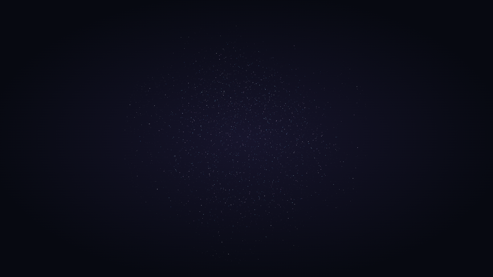

# Vera Atlas

**A living map of memory, models and real processes — on your macOS desktop.**



Vera Atlas is a transparent macOS menu-bar app with a GPU-rendered constellation. Models and knowledge sources are **persistent dots**; instrumented tool calls, document accesses and task attempts are **temporary glowing paths**. It is an observability display, **not** an autonomous agent and not a model launcher.

[Русская документация](README.ru.md) · [Architecture](docs/ARCHITECTURE.md) · [Integrations](docs/INTEGRATIONS.md) · [Privacy](docs/PRIVACY.md)

## Features

- An interactive 3D graph with GPU/WebGL rendering and Canvas fallback.
- Desktop-background or floating panel, zoom, drag, rotation and per-user settings.
- Panoramic ultrawide mode: circular-looking centre; extra space expands near the edges.
- Drag the desktop-backdrop Atlas between displays using Command-drag; the background snaps to the destination display as soon as the cursor crosses the boundary (or on release), and remembers that display for the next launch.
- Switch displays instantly: right-click the menu-bar Atlas icon, choose Move Atlas to the other display or Show Atlas on display and pick a named monitor. The same window moves without restarting; selected screen is remembered. Two simultaneous 3D copies are not enabled by default.
- Toggle static edges / only show confirmed activity; adjustable rotation speed (0–3×).
- **Comets over lines** switch: bright pulses follow the exact visible edge when off; the original 3D comet heads return when on (off by default).
- Local, metadata-only event bus and persisted node identities.
- Optional passive DeepSeek Harness observer and a Python event-emitter example.
- Optional delivery controller: checks event IDs against JavaScript merge receipts, records gaps and can hand off to a separately configured repair callback. No model is started by default.
- **Safe by default:** the first-run graph is reproducible **synthetic** data.

## Requirements

macOS 13 or later, Apple Swift toolchain (Xcode Command Line Tools / Swift 5.9+), Python 3.10+. Node.js is only needed for optional JS syntax checks. The DeepSeek integration optionally needs a compatible DSH installation and `zstd`; the demo does **not**.

## Quick start

```bash
git clone https://github.com/NickPicnick13/vera-atlas.git
cd vera-atlas
python3 -B examples/generate_demo.py
./make_app.sh
open .build/app/VeraAtlas.app
```

This repository can also be built directly from an existing source checkout.

Then, in a **second** terminal:

```bash
python3 -B examples/emit_demo_activity.py --count 15 --delay 0.8
```

Watch distinct demonstration processes illuminate model → attempt → task. This example **never calls a real AI model** and does not need credentials. The emitted paths mean the demo program actually executed those steps, not that a provider processed a request.

The event bus lives at:

```text
~/Library/Application Support/VeraAtlas/atlas-access.jsonl
```

It is not a copy of your chat history or memory database.

## Control

Right-click the menu-bar constellation icon to adjust window positioning, desktop background, idle edges, continuous-work edges, fit-to-screen geometry, zoom, **movement speed (0–3×)** and **Comets over lines**. By default only bright on-edge pulses appear; check the comet option to restore its separate glowing head. Left-click toggles the panel. Drag the graph to rotate; use scrolling to zoom and Shift+drag to pan. Settings are kept in the app's own macOS preferences domain (`org.vera-atlas.community`).

## Connect real events

The public edition deliberately does **not** scan your memory folders, session history or secrets on install. You may opt in to selected sources:

- **Generic processes**: import `record_access` from `scripts/vera_atlas_access.py`. Emit a `process-event` at an actual start or completion; pass stable opaque model/task IDs and a distinct attempt ID.
- **DeepSeek Harness**: enable the optional passive session watcher by supplying explicit folder paths. No paid calls or additional agents are made.
- **ChatGPT and scripts**: use the opt-in workbench event wrapper or emit a confirmed receipt after an actual completed tool call. Not all internal ChatGPT calls can be intercepted.
- **Knowledge source**: use the documented JSON graph schema to replace the synthetic base. Never commit private graph exports.

See [Integrations](docs/INTEGRATIONS.md) for commands and the exact data contract.

## Development

```bash
python3 -B -m unittest discover -s tests -v
node --check sphere.js
node --check atlas.js
node tests/atlas_comets_qa.js
./make_app.sh
.build/app/VeraAtlas.app/Contents/MacOS/VeraAtlas --export-atlas-base
```

The app build uses a local ad-hoc signature. It does not require uploading to Apple, a GitHub token, a model provider, or an account. The included PNG was rendered offline from the **synthetic** demo. Never include personal screenshots, logs, `.build`, `.dsh`, API keys, model responses or real trace data in pull requests.

## Status and expectations

This is a **source release candidate** derived from a personal desktop prototype. The application builds locally and is ad-hoc signed; no notarized binary is provided. Realtime visibility is limited to **instrumented events**; absence of a glowing line is not proof that a model is idle. Optional integrations are source- and format-specific.

**License: MIT.** You can use, modify, share, and sell your own derivatives under its terms. Preserve the copyright and license notice. See [release checklist](docs/RELEASE_CHECKLIST.md) for current distribution limitations.

[Architecture](docs/ARCHITECTURE.md) · [Troubleshooting](docs/TROUBLESHOOTING.md) · [Contributing](CONTRIBUTING.md) · [Security](SECURITY.md)
