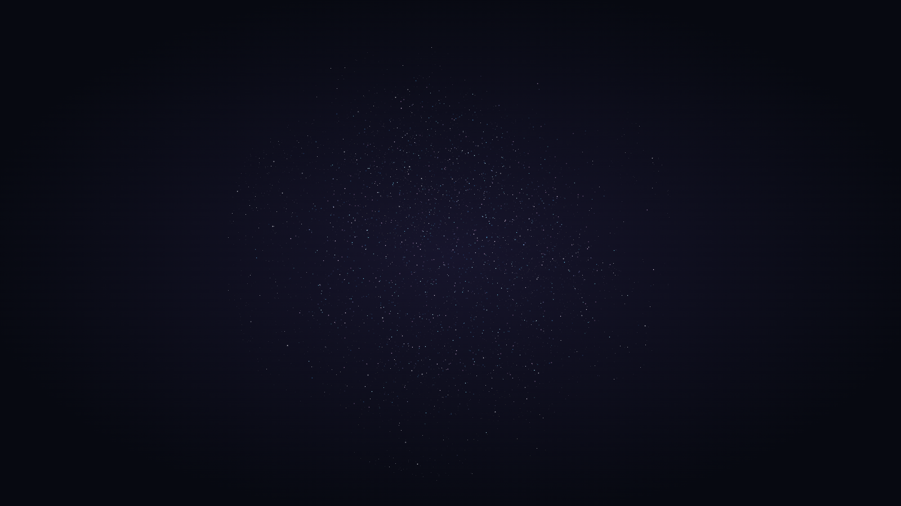

# Атлас памяти Веры

**Живая карта памяти, инструментов, моделей и процессов на рабочем столе macOS.**

[](https://www.youtube.com/watch?v=Zz7Jms8bCrs)

**[▶ Смотреть видеодемонстрацию Vera Atlas на YouTube](https://www.youtube.com/watch?v=Zz7Jms8bCrs)** — показываем живой граф в нашей рабочей конфигурации. Публичный репозиторий содержит отдельный безопасный демонстрационный граф.

[English README](README.md) · [Архитектура](docs/ARCHITECTURE.md) · [Интеграции](docs/INTEGRATIONS.md) · [Конфиденциальность](docs/PRIVACY.md)

## Идея

Атлас — не чат-бот и не ещё один оркестратор. Это **экран наблюдения за реальными действиями ИИ-системы**. Постоянные сущности (модель, инструмент, источник) выглядят как точки. Конкретный процесс (вызов инструмента, обращение к документу, запуск или завершение попытки) становится кратковременно светящейся связью. Никаких выдуманных «модель сейчас думает над X»: источником линии должно быть реально полученное событие.

Прототип возник как персональный дашборд, но эта версия очищена для публикации: **в нём нет персональной базы памяти и нет доступа к личным файлам по умолчанию**.

## Что увидишь после установки

- Сферическую «вселенную» из 4 506 **искусственных** точек и 4 786 связей.
- Ручное вращение, масштабирование и движение камеры.
- Режим большого экрана: середина остаётся круглой, края графа постепенно подстраиваются под ультраширокий монитор.
- Перенос фонового Atlas между мониторами через Command-перетаскивание: при пересечении границы экрана окно сразу подстраивается под второй монитор, даже если macOS не доставит событие отпускания мыши. Выбранный экран запоминается для следующего запуска.
- Переключение без перезапуска: правый клик по значку Atlas в строке меню → «Перенести Atlas на другой монитор» либо «Показать Atlas на экране» → выбрать монитор. Перемещается существующий графический виджет, а не запускается второй тяжёлый рендерер. Одновременное отображение двух независимых копий — отдельный режим.
- Два способа показывать линии: вся слабая сеть постоянно или только реальные события.
- Переключатель постоянной активности исполнителя и ползунок скорости вращения 0–3×.
- Пункт **«Кометы поверх линий»**: яркие импульсы всегда бегут строго по видимым линиям. Галочка добавляет сверху самостоятельные кометы (дуга, зигзаг, спираль вокруг луча или прыжки); их полёт меняется при следующих реальных событиях и не повторяет предыдущий тип на той же связи. Основная трассировка не гаснет и не меняет яркость. Переключается без перезапуска.
- Нативное прозрачное окно AppKit, меню macOS, режим под рабочими окнами.

## Установка на Mac

Потребуется macOS 13+, Xcode Command Line Tools / Swift 5.9+, Python 3.10+. Всё демонстрационное работает без облака, API-ключей и платных моделей.

```bash
git clone https://github.com/NickPicnick13/vera-atlas.git
cd vera-atlas
python3 -B examples/generate_demo.py
./make_app.sh
open .build/app/VeraAtlas.app
```

Если исходники уже находятся на Mac, можно выполнять команды прямо из их папки.

Для проверки живых связей открой **второй** терминал:

```bash
python3 -B examples/emit_demo_activity.py --count 15 --delay 0.8
```

Скрипт выполняет 15 **демонстрационных** этапов и реально записывает их начало и завершение. Он не обращается к NVIDIA, OpenAI или DeepSeek. Имена моделей в примере условные, чтобы никто не перепутал демонстрацию с настоящими API-запросами.

**Два равноправных Atlas:** правый клик по значку в строке меню →
«На обоих мониторах — два полноценных Atlas». Это два самостоятельных
WKWebView/WebGL-рендерера с одинаковыми настоящими событиями и полной
анимацией, а не передача картинки. Сними галочку — второе окно и его
рендерер останавливаются, первое продолжает работать. Пределы FPS и
качества не навязываются, поэтому потребление GPU и RAM возрастёт.
Режим «Кометы поверх линий» работает в обоих окнах. На узком Samsung
комета теперь отчётливо отделяется от трассы, имеет яркое ядро и
увеличенное свечение; на широком Odyssey прежний рисунок сохранён.

### Управление Atlas во время видеодемонстрации

Вместо правки кода или ручного поиска галочки можно отправлять
**подтверждённые локальные команды** работающему приложению:

    python3 -B tools/atlas_live_control.py status
    python3 -B tools/atlas_live_control.py comets on
    python3 -B tools/atlas_live_control.py comets off
    python3 -B tools/atlas_live_control.py idle-lines on
    python3 -B tools/atlas_live_control.py dual on
    python3 -B tools/atlas_live_control.py dual off
    python3 -B tools/atlas_live_control.py screen main
    python3 -B tools/atlas_live_control.py speed 1.2
    python3 -B tools/atlas_live_control.py pinned on
    python3 -B tools/atlas_live_control.py backdrop on
    python3 -B tools/atlas_live_control.py fullscreen on
    python3 -B tools/atlas_live_control.py fullscreen off
    python3 -B tools/atlas_live_control.py work-lines on
    python3 -B tools/atlas_live_control.py adaptive-shape off
    python3 -B tools/atlas_live_control.py zoom-in
    python3 -B tools/atlas_live_control.py zoom-out
    python3 -B tools/atlas_live_control.py universe
    python3 -B tools/atlas_live_control.py reset-view
    python3 -B tools/atlas_live_control.py fit-frame
    python3 -B tools/atlas_live_control.py presentation-small
    python3 -B tools/atlas_live_control.py presentation-full

Команда получает квитанцию от **действительного процесса Atlas**. Для
масштаба подтверждается также фактическая дистанция камеры. `status`
возвращает состояние окна, переключателей и камеры. `pinned on` переводит
фоновый Atlas поверх окон; `fullscreen on` разворачивает настоящее окно,
не создавая отдельный macOS Space. Для возврата к рабочему столу используйте
`fullscreen off`, затем `backdrop on`. По умолчанию CLI обращается только
к публичному приложению и не читает память.
Сценарий короткой живой демонстрации: [docs/LIVE_DEMO_RU.md](docs/LIVE_DEMO_RU.md).
CLI не слушает микрофон; голосовой клиент сможет пользоваться командами
только при доступном коннекторе/инструменте в его собственном режиме.

## Где что находится

| Путь | Для чего |
| --- | --- |
| `Sources/VeraDesktopWidget/` | Swift/AppKit, встроенный WebKit, сборка графа |
| `sphere.js`, `atlas.js`, `proto.html` | Сфера, анимация, графический интерфейс |
| `make_app.sh`, `Package.swift` | Создание приложения |
| `examples/demo-graph.json` | Безопасный искусственный граф |
| `examples/generate_demo.py` | Воспроизводимая генерация демографа |
| `examples/emit_demo_activity.py` | Демонстрация реальных событий скрипта |
| `scripts/vera_atlas_access.py` | Локальная шина событий и её валидация |
| `scripts/vera_atlas_skill_watch.py` | Необязательное пассивное наблюдение Harness |
| `scripts/vera_atlas_controller.py` | Контроль потери событий между локальной шиной и интерфейсом Atlas; никаких модельных вызовов по умолчанию |
| `docs/` | Архитектура, интеграция, безопасность, решение проблем |

### Данные и безопасность

По умолчанию события записываются локально в `~/Library/Application Support/VeraAtlas/atlas-access.jsonl`. Это не полная история переписки. Идентификаторы хешированы; промпты, ответы, секреты и содержимое документов не должны попадать в шину. Источники реальной памяти подключаются только явной настройкой.

**Честное ограничение:** Атлас не может автоматически перехватить *любое* действие ChatGPT, каждого агента и всех подпроцессов. Он показывает события, для которых установлен работающий и проверенный источник. Долгое отсутствие вспышки не означает, что модель перестала работать.

## Подключить свой процесс

В Python можно вызвать `record_access("process-event", ...)` в действительной точке старта/результата своей задачи. Понадобятся непрозрачные стабильные ID модели/задачи и отдельный ID попытки. Примеры без секретов — в [документе интеграций](docs/INTEGRATIONS.md).

Если используешь DeepSeek Harness, подключи пассивный watcher к своей папке сессий через `VERA_ATLAS_DSH_SESSIONS_DIR`. Подключение к Desktop API требует ещё двух **явно заданных** путей. Оно выключено по умолчанию. Чтение событий, связанных с документами и проектами, дополнительно требует явных корневых путей `VERA_ATLAS_DOCUMENT_ROOTS` и `VERA_ATLAS_PROJECTS_ROOT`. Без них документы не отслеживаются.

## Как разрабатывать и проверять

```bash
python3 -B -m unittest discover -s tests -v
node --check sphere.js
node --check atlas.js
node tests/atlas_comets_qa.js
./make_app.sh
```

Сборка подписывается локально ad-hoc, это не нотарифицированный релиз Apple. Папка `.build` в Git **не добавляется**. Для новой версии сборки нужна компиляция Swift, одного копирования JavaScript недостаточно.

## Публикация

**Лицензия MIT**: разрешены использование, изменения, распространение и коммерческие производные при сохранении уведомления об авторских правах и лицензии. Готовый бинарник для скачивания не опубликован: исходники собираются на собственном Mac. См. [чек-лист релиза](docs/RELEASE_CHECKLIST.md).

Обратная связь и баг-репорты приветствуются после открытия репозитория. Без персональных логов и ключей.
